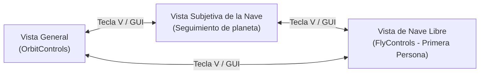

# Sistema Planetario 3D con Three.js
### Práctica 7: Luces, Sombras, Materiales, Cámaras y Control Interactivo
**Asignatura:** Informática Gráfica   
**Titulación:** Grado en Ingeniería Informática  
**Centro:** Escuela de Ingeniería Informática (EII), Universidad de Las Palmas de Gran Canaria (ULPGC)  
**Autor:** Álvaro García Suárez  

---

## Vídeo Demostrativo de Ejecución

> [!IMPORTANT]
> A continuación se deja preparado el espacio para enlazar la grabación de la ejecución del proyecto, requerida para la entrega de la práctica.

* **Enlace al vídeo:** [Ver vídeo de demostración en YouTube / Google Drive](URL_DEL_VIDEO_AQUI) *(Sustituir por el enlace definitivo)*
* **Archivo local / descarga alternativa:** `video_demostracion.mp4` *(o enlace al archivo en la nube)*

<!-- Espacio reservado para miniatura o GIF de vista previa -->
[](URL_DEL_VIDEO_AQUI)

> **Puntos clave demostrados en el vídeo:**
> 1. **Autoría en pantalla:** Indicador fijo visible en la esquina inferior izquierda (*Álvaro García Suárez · Informática Gráfica*).
> 2. **Iluminación y sombras dinámicas:** Luz puntual central en el Sol, sombras suaves (`PCFSoftShadowMap`) proyectadas y recibidas en planetas, lunas y anillos.
> 3. **Materiales y texturas:** Vista detallada de la Tierra con relieve (`bumpMap`), brillo oceánico (`specularMap`) y atmósfera de nubes independiente con transparencia (`alphaMap`).
> 4. **Sistema de cámaras y vistas:**
>    - Vista General orbital interactiva (`OrbitControls`).
>    - Vista Subjetiva de la Nave siguiendo a planetas a distancia y altura personalizables.
>    - Vista de Nave Libre con controles de simulador de vuelo (`FlyControls` con WASD, RF, QE y ratón).
> 5. **Interacción didáctica y gizmos:** Clic en astros para abrir fichas didácticas con datos reales y curiosidades, manipulación interactiva de órbitas mediante `TransformControls` (recalculando la órbita según la 3ª ley de Kepler al soltar) y creación/borrado dinámico de planetas.

---

## 🚀 Guía de Instalación y Ejecución

Para ejecutar el proyecto en local es necesario contar con [Node.js](https://nodejs.org/) (versión 14 o superior) y el gestor de paquetes `npm`.

### 1. Clonar el repositorio y acceder a la carpeta de la práctica
```bash
git clone https://github.com/agsuarezz/IG.git
cd IG/S7
```

### 2. Instalación de dependencias
Instala los paquetes requeridos por el proyecto.:
```bash
npm install
```

### 3. Ejecutar el servidor de desarrollo
Inicia el entorno de desarrollo con Parcel.
```bash
npm start
```

---

##  Descripción del Trabajo Realizado

La práctica consiste en el diseño, desarrollo e implementación de un **sistema planetario 3D completo e interactivo** utilizando la librería **Three.js**, haciendo especial énfasis en el tratamiento físico de luces, mapas de sombras, materiales avanzados con múltiples texturas, jerarquías de transformación, control de cámaras y una interfaz de usuario didáctica y configurable.

### 1. Modelado del Sistema Planetario
El sistema recrea a escala didáctica los cuerpos principales del Sistema Solar:
* **El Sol:** Estrella central emisora de luz modelada con textura propia (`sun.jpg`) y una rotación axial continua.
* **8 Planetas Reales:**
  1. **Mercurio:** Rocoso interior, textura `mercury.jpg`, órbita rápida.
  2. **Venus:** Rotación retrógrada y textura `venus.jpg`.
  3. **Tierra:** Modelo multicapa realista que incluye:
     - Superficie con textura difusa de alta definición (`earth.jpg`).
     - Mapa de rugosidad / relieve (`earthbump1k.jpg`, `bumpScale = 0.5`) para realzar cordilleras y accidentes geográficos con la incidencia de la luz.
     - Mapa especular (`earthspec1k.jpg`) para conseguir reflejos realistas en mares y océanos contrastando con la superficie continental opaca.
     - Capa atmosférica de nubes: Esfera independiente concéntrica con radio 1.03× que combina textura difusa de nubes (`earthcloudmap.jpg`) y mapa de transparencia / alpha invertido (`earthcloudmaptrans_invert.jpg`), con rotación un 20 % más rápida que la superficie terrestre.
  4. **Marte:** Superficie rojiza con textura `mars.jpg` y sistema de 2 satélites naturales.
  5. **Júpiter:** Gigante gaseoso con bandas atmosféricas (`jupiter.jpg`) y 2 lunas galileanas.
  6. **Saturno:** Planeta gaseoso (`saturn.jpg`) con un sistema complejo de **anillos concéntricos** (`RingGeometry`) con coordenadas de textura UV generadas para mapear `saturn_ring.png` con canal alfa y capacidad de proyectar y recibir sombras tanto sobre el planeta como desde este.
  7. **Urano:** Textura `uranus.jpg` y eje de rotación característico.
  8. **Neptuno:** Planeta exterior con textura `neptune.jpg`.
* **Sistema de Lunas (Satélites Naturales):**
  - **Tierra:** La Luna (`moon.jpg`).
  - **Marte:** Fobos y Deimos.
  - **Júpiter:** Ío y Europa.
  - **Saturno:** Titán.
  - Las lunas se modelan mediante **coordenadas locales jerárquicas** (`THREE.Group`), orbitando de manera solidaria a sus respectivos planetas mientras estos giran alrededor del Sol.
* **Fondo Espacial Inmersivo:** Gran esfera de fondo envolvente con radio de 900 unidades y textura de cielo estrellado 360° (`fondo.jpg`) mapeada por su cara interior (`THREE.BackSide`).

---

## Iluminación, Sombras y Materiales

### Modelo de Iluminación
1. **Luz Puntual (`PointLight`):**
   - Situada en el centro del Sol emitiendo luz omnidireccional blanca a toda la escena.
   - Configurada como productora de sombras.
2. **Luz Ambiente (`AmbientLight`):**
   - Luz blanca homogénea de baja intensidad (0.15) que simula la luz difusa permitiendo distinguir suavemente las caras nocturnas de los planetas.

### Renderizado de Sombras Suaves
* Activación del motor de sombras en el renderizador: `renderer.shadowMap.enabled = true`.
* Tipo de sombra: `THREE.PCFSoftShadowMap` (*Percentage Closer Filtering* suavizado), que proporciona penumbras graduales y realistas.
* Todos los planetas, lunas y anillos tienen activadas tanto la proyección (`castShadow = true`) como la recepción de sombras (`receiveShadow = true`).

### Materiales
* **Materiales Phong (`MeshPhongMaterial`):** Empleados en todos los cuerpos celestes que interactúan con la luz del Sol, permitiendo reflexiones difusas y especulares (*Blinn-Phong*).
* **Materiales Básicos (`MeshBasicMaterial`):** Empleados exclusivamente en el Sol (para que actúe como emisor sin sombras impropias) y en la cúpula de estrellas de fondo.

##  Sistemas de Vistas y Cámaras

La aplicación cumple e incrementa el requisito de alternancia de vistas, implementando **tres modos de visualización**:



1. **Vista General (Orbital):**
   - Utiliza `OrbitControls`.
   - Permite rotar libremente la escena alrededor del centro, hacer zoom y paneo para tener una visión panorámica de todo el sistema y sus órbitas.
2. **Vista Subjetiva de la Nave:**
   - La cámara (`camNave`) se posiciona en una órbita respecto a cualquiera de los planetas del sistema.
   - Se sitúa estratégicamente entre el Sol y el planeta para enfocar siempre su cara diurna e iluminada.
   - Parámetros dinámicos desde la GUI: selector del planeta a seguir, distancia de observación (en múltiplos del radio del planeta), altura orbital y orientación (mirar al planeta o mirar hacia el Sol).
3. **Vista de Nave Libre / Simulador de Vuelo (`FlyControls`):**
   - Permite al usuario pilotar una nave espacial en primera persona en 6 grados de libertad por todo el espacio 3D.
   - **Transición suave:** Al entrar en este modo, la cámara libre hereda la posición y rotación de la cámara previa para evitar saltos bruscos.
   - Velocidad de vuelo ajustable en tiempo real.

---

## Controles de la Aplicación e Interfaz

La aplicación dispone de una **interfaz autocompleta** que no requiere leer documentación para interactuar:

### Teclado y Ratón
| Acción | Control | Descripción |
| :--- | :---: | :--- |
| **Cambiar de Vista** | <kbd>V</kbd> | Alterna cíclicamente entre *General*, *Nave* y *Nave libre*. |
| **Cambiar Planeta Seguido** | <kbd>N</kbd> | Pasa al siguiente planeta en la vista de la nave. |
| **Cerrar Ficha Didáctica** | <kbd>Esc</kbd> | Cierra la tarjeta informativa y deselecciona el astro. |
| **Seleccionar Astro** | Clic izquierdo | Abre la ficha didáctica del Sol o planeta y resalta su órbita. |
| **Crear Planeta Rápido** | Clic en espacio vacío | Crea un nuevo planeta procedural en la posición del plano orbital. |
| **Mover Planeta** | Arrastrar flechas | Mueve el planeta seleccionado por el plano orbital con `TransformControls`. |
| **Nave Libre: Avance / Retroceso** | <kbd>W</kbd> / <kbd>S</kbd> | Movimiento hacia adelante / atrás. |
| **Nave Libre: Desplazamiento Lateral** | <kbd>A</kbd> / <kbd>D</kbd> | Movimiento izquierda / derecha. |
| **Nave Libre: Altura** | <kbd>R</kbd> / <kbd>F</kbd> | Ascender / descender en el eje vertical. |
| **Nave Libre: Alabeo (Roll)** | <kbd>Q</kbd> / <kbd>E</kbd> | Rotación sobre el eje longitudinal de la nave. |
| **Nave Libre: Orientación** | Arrastrar ratón | Control de cabeceo (*pitch*) y guiñada (*yaw*). |

### Panel de Control `lil-gui`
* **General:** Selector de vista, multiplicador de velocidad temporal, intensidad luminosa del Sol, conmutador de visualización de órbitas y etiquetas de texto, y activación del gizmo de movimiento.
* **Nave:** Selector del planeta objetivo, distancia en radios, altura, punto de mira (*Planeta* o *Sol*) y velocidad de vuelo libre.
* **Planetas:** Botones para **Añadir planeta aleatorio** y **Borrar último planeta**.

---

## Características Extra Implementadas para Subir Nota

De acuerdo con las sugerencias de la guía de la práctica, se han incorporado las siguientes mejoras:

1. **Fichas Didácticas Interactivas con Datos Astronómicos Reales:**
   - Al hacer clic sobre cualquier astro (Sol o planetas), se abre una tarjeta lateral con información astronómica verídica: diámetro, distancia al Sol, duración del año y del día, número de satélites conocidos y una curiosidad científica destacada.
2. **Etiquetado Visual Dinámico de Astrometría:**
   - Nombres de planetas y del Sol proyectados en 2D en tiempo real sobre la pantalla a partir de sus coordenadas tridimensionales de mundo (`THREE.Vector3.project(cam)`).
   - Las etiquetas de las lunas se ocultan automáticamente a larga distancia y solo se muestran cuando la cámara se aproxima a menos de 14 unidades para evitar saturar la vista.
3. **Control de Transformación Dinámico (`TransformControls`):**
   - Al seleccionar un planeta en la vista general, aparece un gizmo de flechas en el plano $XY$.
   - El usuario puede arrastrar el planeta a una nueva posición orbital; durante el arrastre se restringe el movimiento al plano y se evita que colisione con el Sol.
   - **Física reactiva:** Al soltar el planeta, se recalculan automáticamente su nueva distancia al Sol, la geometría de la órbita dibujada y su nueva velocidad angular según la 3ª Ley de Kepler, actualizando también los datos de su ficha didáctica.
4. **Generación Procedural y Destrucción Dinámica de Planetas:**
   - Mediante un clic sobre cualquier zona vacía del plano orbital o mediante la GUI, se crean dinámicamente nuevos planetas con semiejes, radios, colores y posibilidad de generar lunas y fichas didácticas personalizadas.
5. **Autoría en Pantalla Integrada:**
   - La interfaz muestra de forma permanente y no intrusiva el nombre del autor y asignatura en la esquina inferior izquierda.

---

## Fuentes y Referencias

* **Documentación Oficial:**
  - [Three.js Documentation](https://threejs.org/docs/): Módulos principales, `MeshPhongMaterial`, `DirectionalLight`, `PointLight`, `PCFSoftShadowMap` y `TransformControls`.
  - [Three.js Examples](https://threejs.org/examples/): Referencias de `FlyControls`, `OrbitControls` y mapeo de texturas planetarias.
  - [lil-gui Documentation](https://lil-gui.georgealways.com/): Configuración y personalización de paneles de control.
* **Texturas y Recursos Gráficos:**
  - [Solar System Scope Textures](https://www.solarsystemscope.com/textures/): Mapas de textura de alta resolución de planetas y estrellas.

---

## Declaración de Asistencia con Herramientas de IA

* **Herramientas Utilizadas:** Google modelo Gemini 3.8.
* **Ámbitos de Asistencia:**
  1. *Arquitectura y modularización:* Asesoría en la integración conjunta de `TransformControls`, `FlyControls` y `OrbitControls`, gestionando la activación y desactivación de eventos para evitar interferencias en el canvas WebGL.
  2. *Cálculo matemático orbital:* Soporte en las fórmulas de proyección y ajuste de la tercera ley de Kepler tras la finalización del arrastre de planetas.
  3. *Depuración:* Solución de artefactos de sombreado en anillos con transparencias y ajuste de proyecciones para las etiquetas HTML sobre la escena 3D.
  4. *Documentación técnica:* Estructuración rigurosa y redacción del presente documento de entrega conforme a los criterios de evaluación.
