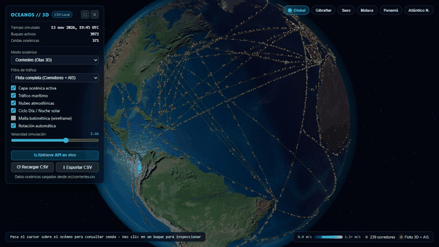

# OCEANOS // 3D — Visualización Geográfica Global en Three.js

Visualización geográfica interactiva en **3D** desarrollada con **Three.js (ES Modules + `OrbitControls`)** que integra sobre un globo terráqueo con relieve batimétrico dos capas globales en movimiento: **corrientes oceánicas / oleaje / temperatura del mar (SST)** mediante *shaders* GLSL y **tráfico marítimo global + AIS en tiempo real** con más de **3.900 buques 3D instanciados**.

> Proyecto desarrollado para la asignatura **Informática Gráfica (IG — Sesión 8)** de la ULPGC.

---

## Demo en funcionamiento



- **Vídeo completo en HD (1280×720, 14,9 s):** [`assets/demo.mp4`](assets/demo.mp4)

<details>
<summary>Ver capturas de detalle (Modo SST e Inspector de Buques en Gibraltar)</summary>

| Temperatura Superficial del Mar (SST) y luces nocturnas | Inspector de buque en Gibraltar y seguimiento de cámara |
| :---: | :---: |
|  |  |

</details>

---

## Cómo funciona (Arquitectura técnica)

La aplicación arranca en [`index.html`](index.html) cargando Three.js `0.170.0` vía `<script type="importmap">` sin necesidad de compilador ni backend, y ejecuta toda la escena desde [`main.js`](main.js):

### 1. Mapeo geográfico esférico (`Map2Range` + coordenadas esféricas)
Siguiendo el estilo base de la asignatura (`Map2Range`), las coordenadas geográficas `lat ∈ [-90, 90]` y `lon ∈ [-180, 180]` se transforman a coordenadas cartesianas 3D sobre la esfera en [`latLonToVector3()`](main.js#L291) y su inversa [`vector3ToLatLon()`](main.js#L303) para alinear exactamente relieve, *shaders*, sonda del ratón, rutas y buques.

### 2. Globo terráqueo 4K, ciclo Día/Noche solar y atmósfera
En [`crearGloboTierra()`](main.js#L316) se construye una `SphereGeometry(2.4, 240, 120)` con `MeshPhongMaterial` combinando:
- **Textura satelital (`src/earth_4k.jpg`)**, **mapa de normales (`src/earth_normal_2k.jpg`)** y **máscara especular de océanos (`src/water_mask_4k.png`)**.
- **Batimetría y relieve (`displacementMap`):** `src/gebco_bathy.5400x2700_8bit.jpg` (`displacementScale = 0.085`, `displacementBias = -0.055`), observable activando *Malla batimétrica (wireframe)*.
- **Ciclo Día/Noche astronómico:** [`actualizarSol()`](main.js#L460) calcula la declinación y longitud solar a partir del reloj UTC simulado y actualiza un parche GLSL (`onBeforeCompile`) sobre `emissiveMap` (`src/earth_lights_2k.png`) para que las luces urbanas solo brillen en el hemisferio nocturno.
- **Atmósfera y nubes 3D:** halo atmosférico en `AdditiveBlending` ([`crearAtmosfera()`](main.js#L400)) y esfera semitransparente de nubes (`src/earth_clouds_1024.png`) en rotación continua ([`crearCapaNubes()`](main.js#L386)).

### 3. Capa 1: Olas 3D advectadas, SST y Oleaje (`ShaderMaterial` + `DataTexture`)
En lugar de partículas estáticas, [`crearCapaOlas()`](main.js#L532) y [`aplicarCampoCorrientes()`](main.js#L1000) generan dos texturas de datos flotantes en GPU (`144×72`) interpoladas bilinealmente desde las celdas oceánicas:
- **`texturaCorrientes`:** componentes `(u, v)` en canales `R/G` y magnitud `speed` en `B`.
- **`texturaAmbiente`:** altura significativa de ola (`wave_height`) en `R` y temperatura superficial del mar (`sst`) en `G`.

El *vertex* y *fragment shader* realizan:
1. **Máscara tierra/mar:** descartan fragmentos sobre tierra usando `src/water_mask_4k.png` (también muestreada en CPU a `720×360` por [`esOceano()`](main.js#L520)).
2. **Deformación de olas:** ondas sinusoidales alineadas con la dirección local del flujo 3D (`flow3D`) en el plano tangente a la esfera.
3. **Advección triplanar de normales:** [`sampleTriplanarWater()`](main.js#L674) proyecta `src/waternormals.jpg` sin costuras ni distorsión polar y mezcla dos fases temporales advectadas por el campo de corrientes con iluminación especular solar y efecto Fresnel.
4. **3 modos visuales (`uOceanMode`):** *Corrientes (Olas 3D)*, *Temperatura del mar (SST)* y *Altura de oleaje (m)* con leyenda dinámica.

### 4. Capa 2: Tráfico marítimo global y buques AIS (`InstancedMesh`)
- **Corredores globales:** [`muestrearArcoEsferico()`](main.js#L1407) interpola geodésicamente los waypoints de los **239 corredores** de `src/rutas_maritimas.csv` y los dibuja con `THREE.LineSegments`.
- **Flota 3D texturizada:** [`crearGeometriaBarco()`](main.js#L1142) y [`crearTexturasBarco()`](main.js#L1060) construyen un carguero 3D y dos `CanvasTexture` procedurales (casco, contenedores de colores y puente + luces de navegación emisivas).
- **Renderizado instanciado:** tanto la flota comercial (`mallaBarcos`) como los buques AIS reales (`mallaAIS`) se renderizan mediante `THREE.InstancedMesh` orientados cada fotograma sobre la esfera con [`orientarBarcoEnEsfera()`](main.js#L1534).

### 5. Sonda oceanográfica, Inspector de Buques y Cámara (*Raycasting*)
- **Sonda en tiempo real:** [`actualizarSondaOceanografica()`](main.js#L1751) proyecta el puntero sobre la esfera con `THREE.Raycaster`, consulta `esOceano()` e interpola corriente (m/s, nudos y rumbo), ola y SST bajo el cursor.
- **Inspector de buques:** al hacer clic en un barco ([`intentarSeleccionarBarco()`](main.js#L1781)), se calcula su rumbo, velocidad y si navega **A favor** o **En contra** de la corriente local. Si pertenece a la capa AIS real, consulta su nombre, eslora y destino en la API de Digitraffic (`consultarMetadatosAIS()`).
- **Seguimiento y *Fly-To*:** el botón **Seguir buque** acopla `OrbitControls` al buque seleccionado, y los presets superiores (`Global`, `Gibraltar`, `Suez`, `Malaca`, `Panamá`, `Atlántico N.`) realizan transiciones suaves de cámara.

---

## Fuentes de datos y APIs

Al abrir la página se cargan inmediatamente los CSV pregenerados en `src/`, con respaldo procedural si alguno faltase. Al pulsar **Retrieve API en vivo** (o al inspeccionar un buque AIS), el navegador consulta directamente APIs públicas abiertas:

| Capa | Archivo local | Fuente / API en vivo | Variables |
| :--- | :--- | :--- | :--- |
| **Océano** | [`src/corrientes.csv`](src/corrientes.csv) | **Open-Meteo Marine API** (`https://marine-api.open-meteo.com/v1/marine`) | `u`, `v`, `wave_height`, `sea_surface_temperature` |
| **Corredores** | [`src/rutas_maritimas.csv`](src/rutas_maritimas.csv) | `Shipping_Lanes_v1.geojson` (`newzealandpaul/Shipping-Lanes`) | 239 corredores (`Major`, `Middle`, `Minor`) |
| **Barcos reales** | [`src/ais_live.csv`](src/ais_live.csv) | **Digitraffic Marine AIS API** (`meri.digitraffic.fi/api/ais/v1/...`) | Posiciones (`locations`) y ficha del buque (`vessels/{mmsi}`) |

Consulta [`DATA_FORMAT.md`](DATA_FORMAT.md) si deseas sustituir los CSV por datasets propios de **NOAA**, **Copernicus (CMEMS)** o **MarineCadastre**.

---

## Controles de la interfaz

- **Ratón / Táctil:** arrastrar para rotar el globo, rueda para hacer zoom, pasar el cursor sobre el mar para ver la sonda, clic en cualquier barco para inspeccionarlo.
- **Modo oceánico:** alterna entre *Corrientes (Olas 3D)*, *Temperatura del mar (SST)* y *Altura de oleaje (m)*.
- **Filtro de tráfico:** muestra toda la flota, solo corredores principales (`Major`) o únicamente buques AIS en tiempo real.
- **Capas y ciclo solar:** activa/desactiva olas, tráfico marítimo, nubes, ciclo Día/Noche solar, malla batimétrica (`wireframe`) y rotación automática.
- **Presets de cámara:** salto animado a *Global*, *Gibraltar*, *Suez*, *Malaca*, *Panamá* y *Atlántico N.*
- **Datos en vivo:** **Retrieve API en vivo** descarga datos actuales desde Open-Meteo + Digitraffic y **Exportar CSV** permite guardar el campo resultante.
- **Tecla `H` / botón `✕`:** oculta o muestra el panel HUD para vista limpia.

---

## Estructura del proyecto

```text
.
├── index.html                  # Estructura HTML, HUD, importmap de Three.js 0.170.0
├── style.css                   # Estética oscura/nocturna, leyenda cromática e inspector
├── main.js                     # Escena 3D, shaders GLSL, tráfico instanciado y APIs
├── DATA_FORMAT.md              # Esquema de los CSV y conversión desde NOAA/CMEMS
├── assets/
│   ├── demo.gif                # Demostración animada para README
│   ├── demo.mp4                # Captura en vídeo HD (14,9 s)
│   ├── preview_sst.jpg         # Captura en modo SST
│   └── preview_inspector.jpg   # Captura de inspección y seguimiento de buques
└── src/
    ├── corrientes.csv          # Campo oceánico global (lat;lon;u;v;wave_height;sst)
    ├── rutas_maritimas.csv     # 239 corredores marítimos globales
    ├── ais_live.csv            # Instantánea AIS real (Digitraffic)
    ├── earth_4k.jpg            # Mapa satelital diurno 4K
    ├── earth_lights_2k.png     # Luces urbanas nocturnas 2K
    ├── earth_normal_2k.jpg     # Relieve normal 2K
    ├── earth_clouds_1024.png   # Capa atmosférica de nubes con alfa
    ├── water_mask_4k.png       # Máscara tierra/océano 4K
    ├── waternormals.jpg        # Mapa de normales repetible para olas
    ├── gebco_bathy.5400x2700_8bit.jpg  # Mapa de desplazamiento batimétrico/topográfico
    └── earthmap1k.jpg          # Textura de respaldo
```

---

## Ejecución local y despliegue en CodeSandbox

### Opción 1: Servidor local (recomendado en desarrollo)
```bash
python -m http.server 8080
```
Abre `http://localhost:8080/` en el navegador. También puedes servirlo con `npx serve`.

### Opción 2: Subir a CodeSandbox (sin Python)
La aplicación web es **100 % estática (HTML/CSS/JS)** e incluye los CSV pregenerados en `src/`:
1. Crea un sandbox en CodeSandbox con la plantilla **Static (HTML / CSS / JS)**.
2. Sube `index.html`, `style.css`, `main.js` y la carpeta `src/` (o importa directamente este repositorio desde GitHub).
3. El proyecto funcionará directamente con el `<script type="importmap">` y permitirá actualizar datos reales desde Open-Meteo y Digitraffic mediante **Retrieve API en vivo**.
