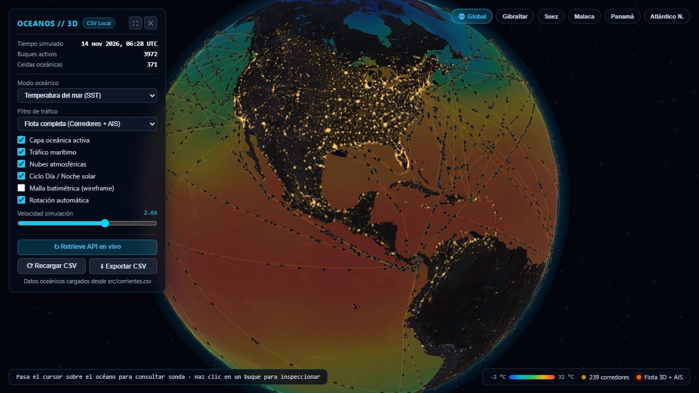
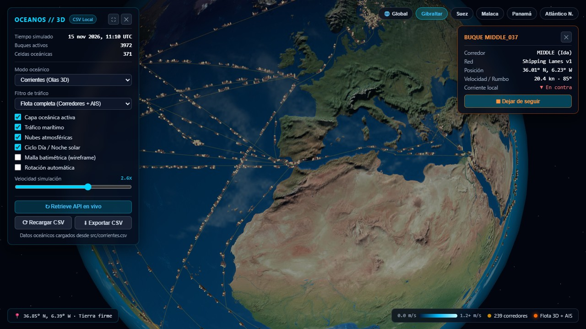

# OCEANOS // 3D

Visualización geográfica 3D con **Three.js (ES Modules + `OrbitControls`)** que combina sobre un globo con batimetría **corrientes oceánicas, oleaje y SST** (*shaders* GLSL) junto a **tráfico marítimo global y buques AIS reales** (**Informática Gráfica — S8, ULPGC**).

## Demo

- **Vídeo HD (14,9 s):** [`assets/demo.mp4`](assets/demo.mp4)

Capturas adicionales (SST e Inspector en Gibraltar)

| Temperatura del mar (SST) | Inspector y seguimiento de buque |
| :---: | :---: |
|  |  |

## Cómo funciona

- **Globo y ciclo Día/Noche:** Esfera (`SphereGeometry` 240×120) mapeada con [`Map2Range()`](main.js#L286) y [`latLonToVector3()`](main.js#L291), relieve por `displacementMap` (`gebco_bathy`), luces nocturnas visibles solo en sombra solar (`onBeforeCompile`), halo atmosférico y capa de nubes.
- **Océano 3D en 3 modos:** *Shader* GLSL alimentado por dos `DataTexture` (144×72) que deforma olas según el flujo `(u, v)`, aplica normales triplanares (`waternormals.jpg`) filtradas con `water_mask_4k.png` y alterna entre **Corrientes**, **SST** y **Altura de oleaje**.
- **Tráfico marítimo (`InstancedMesh`):** 239 corredores globales interpolados sobre la esfera (`LineSegments`) y >3.900 cargueros 3D con textura procedural (`CanvasTexture`), sumando buques AIS en directo.
- **Interacción (`Raycaster`):** Sonda oceanográfica bajo el cursor, clic en barcos para ver rumbo, corriente a favor/contra y ficha AIS real, botón **Seguir buque** y saltos de cámara (*Global, Gibraltar, Suez, Malaca, Panamá, Atlántico N.*).

## Datos y APIs

Arranca desde CSV locales en `src/` y se actualiza en directo al pulsar **Retrieve API en vivo**:

| Capa | CSV local | API / Fuente en vivo |
| :--- | :--- | :--- |
| **Océano (`u, v, ola, sst`)** | [`src/corrientes.csv`](src/corrientes.csv) | **Open-Meteo Marine API** |
| **Corredores (239 rutas)** | [`src/rutas_maritimas.csv`](src/rutas_maritimas.csv) | `Shipping_Lanes_v1.geojson` |
| **Buques reales (AIS)** | [`src/ais_live.csv`](src/ais_live.csv) | **Digitraffic Marine AIS** (`/locations` y `/vessels/{mmsi}`) |

Esquema de los CSV en [`DATA_FORMAT.md`](DATA_FORMAT.md).

## Ejecución

- **Local:** ejecuta `python -m http.server 8080` (o `npx serve`) y abre `http://localhost:8080/`.
- **CodeSandbox:** sube `index.html`, `style.css`, `main.js` y `src/` a una plantilla **Static (HTML / CSS / JS)** (no requiere Python ni *bundler*).
- **Atajos:** tecla `H` oculta/muestra el HUD; rueda/arrastre con ratón para navegar por el globo.
