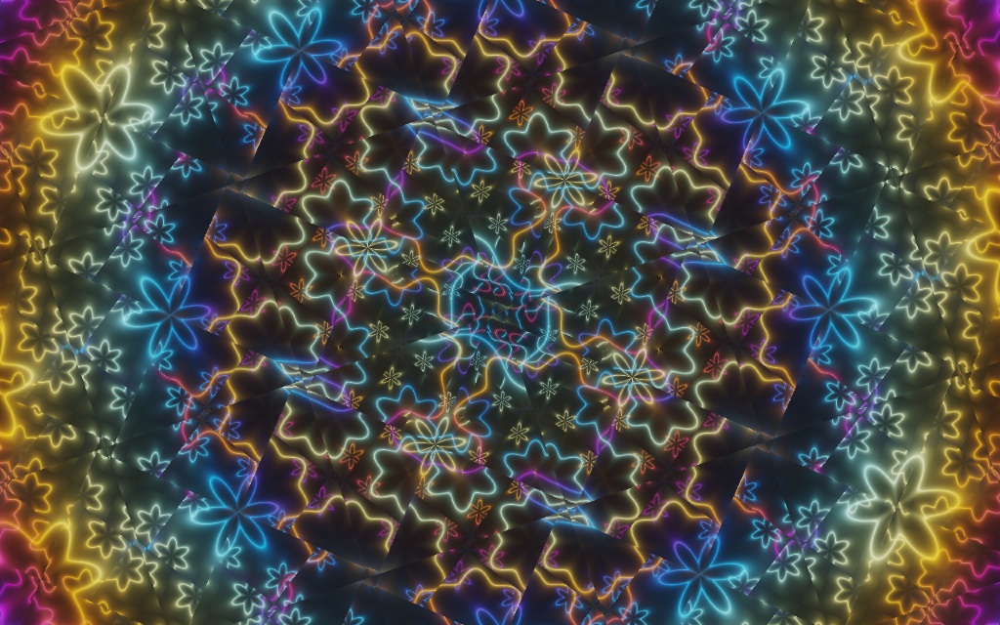
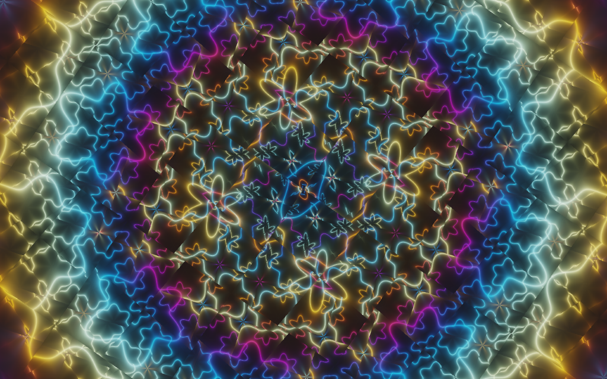
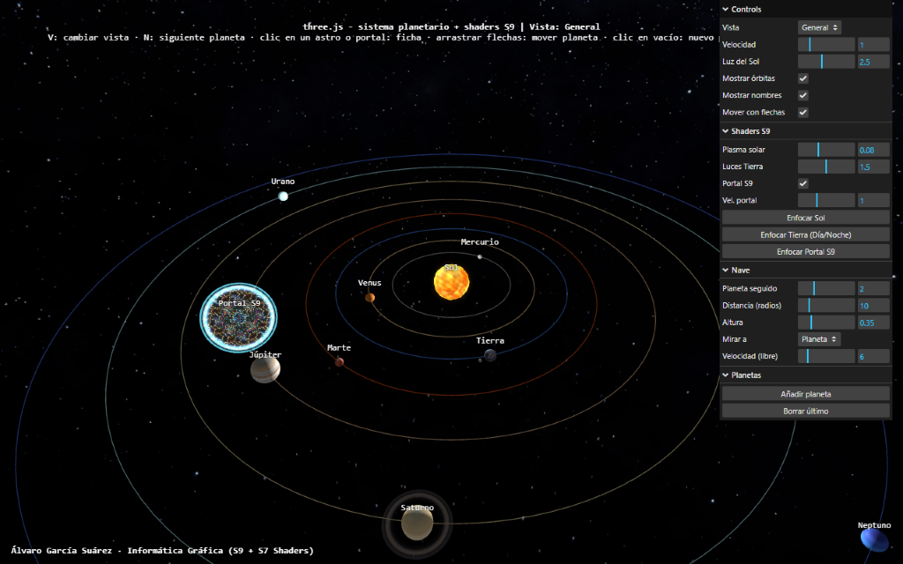
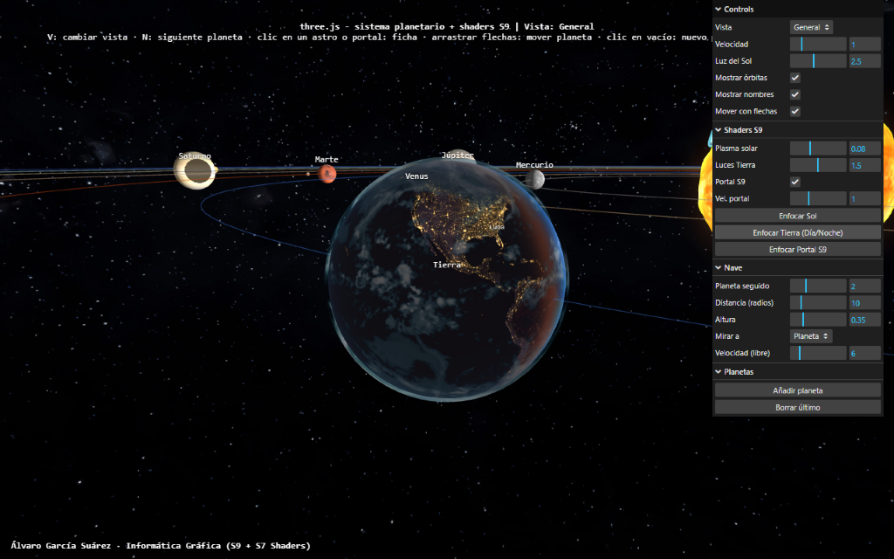

# Práctica IG S9 — Shader de Fragmentos Generativo (*Tiny Code*)

**Enlace en vivo:** [https://codesandbox.io/p/sandbox/entrega-s9-nxp6lx](https://codesandbox.io/p/sandbox/entrega-s9-nxp6lx)

| Instante 1 | Instante 2 |
| :---: | :---: |
|  |  |

## 1. Motivación

La idea de este *shader* es recrear la sensación que se tiene al mirar por un **caleidoscopio**, con formas simétricas que se repiten, giran y cambian de color todo el tiempo. Además, las estrellas brillantes que van apareciendo y expandiéndose recuerdan a **fuegos artificiales** sobre un fondo oscuro.

Para conseguir este efecto en menos de 512 bytes (y que se vea bien tanto en *The Book of Shaders* como en un *reel*), el código combina cuatro técnicas vistas en la práctica S9:
1. **Patrones repetitivos con `fract`** para dividir el espacio en varias capas.
2. **Rotación 2D con matrices (`mat2`)** animada con `u_time`.
3. **Coordenadas polares (`atan`, `length`)** para crear las formas de estrellas de 6 puntas.
4. **Ondas radiales y una paleta de colores con coseno** para dar brillo y cambiar de color de forma suave sin usar texturas.

Al ajustar las coordenadas con `min(u_resolution.x, u_resolution.y)` y usar solo `u_resolution` y `u_time`, el resultado no se deforma en ningún tamaño de pantalla (`1:1`, `16:9` o `9:16`) y se anima solo.

---

## 2. Código del shader ([shader.frag](./shader.frag) — 493 bytes)

```glsl
precision mediump float;
uniform vec2 u_resolution;
uniform float u_time;
void main(){
vec2 r=u_resolution,u=(gl_FragCoord.xy*2.-r)/min(r.x,r.y);
float d0=length(u),t=u_time,a,c,s,d;vec3 o=vec3(0.);
for(float i=0.;i<4.;i++){
a=t*.15+i*.5;c=cos(a);s=sin(a);
u=fract(mat2(c,-s,s,c)*u*1.5)-.5;
d=(length(u)+.07*cos(6.*atan(u.y,u.x+1e-5)+t*2.-i))*exp(-d0);
d=pow(.096/(abs(sin(d*8.-t*1.6+i))+.016),1.15);
o+=(.5+.5*cos(6.283*(d0+i*.35-t*.25+vec3(0.,.2,.4))))*d;
}
gl_FragColor=vec4(o/(1.+o),1.);
}
```

---

## 3. Desarrollo paso a paso

1. **Centrado y normalización independiente del aspecto**:
   `u = (gl_FragCoord.xy * 2. - r) / min(r.x, r.y)` lleva el origen al centro de la pantalla sin deformaciones en `1:1`, `16:9` o `9:16`. Se guarda `d0 = length(u)` como distancia radial global antes de subdividir el espacio.
2. **Bucle fractal de 4 octavas (`i = 0..3`)**:
   En cada iteración se rota el plano un ángulo `a = t * 0.15 + i * 0.5` mediante `mat2(c, -s, s, c)` y se aplica un teselado recursivo centrado con `fract(... * 1.5) - 0.5`. El factor no entero `1.5` evita una rejilla trivial y crea interferencias autosimilares.
3. **Modulación polar en rosetón y envolvente global**:
   `length(u) + 0.07 * cos(6. * atan(u.y, u.x + 1e-5) + t * 2. - i)` añade simetría rotacional de 6 pétalos animados en cada celda (el `+ 1e-5` evita `atan(0, 0)` indefinido en GLSL ES 1.00). Multiplicar por `exp(-d0)` atenúa el campo hacia el exterior y concentra el foco visual.
4. **Ondas de interferencia y brillo neón**:
   `pow(0.096 / (abs(sin(d * 8. - t * 1.6 + i)) + 0.016), 1.15)` convierte los ceros de la onda sinusoidal móvil en curvas luminosas de alto contraste, con `+ 0.016` para evitar divisiones por cero.
5. **Paleta cosenoidal procedural (Inigo Quilez)**:
   `0.5 + 0.5 * cos(6.283 * (d0 + i * 0.35 - t * 0.25 + vec3(0., 0.2, 0.4)))` colorea cada octava con un gradiente continuo en tonos dorados, cianes, azules y magentas.
6. **Mapeo tonal de Reinhard**:
   `o / (1. + o)` comprime el rango dinámico al sumar las 4 capas aditivas para mantener la nitidez cromática sin quemar a blanco plano.

---

### Ejecución en *The Book of Shaders Editor*
Copiar y pegar directamente el contenido de [shader.frag](./shader.frag) en [http://editor.thebookofshaders.com](http://editor.thebookofshaders.com).

---

## 4. Extra: Integración de shaders en S7 ([ShaderS7](./ShaderS7/))

**Enlace en vivo (`ShaderS7`):** [https://codesandbox.io/p/sandbox/entrega-s9-s7-shader-fcl54y](https://codesandbox.io/p/sandbox/entrega-s9-s7-shader-fcl54y)

Como extra, se ha creado una versión con shaders de la práctica **S7 (Sistema Planetario 3D)** dentro de [ShaderS7/](./ShaderS7/), integrando tres shaders GLSL:
- **Sol de plasma + corona**: superficie solar animada y corona luminosa alrededor.
- **Tierra Día/Noche + atmósfera**: transición entre la cara diurna (`earth.jpg`) y las luces nocturnas (`earth_lights_2k.png`) según la dirección del Sol, con halo atmosférico azulado.
- **Portal Caleidoscópico S9**: integración directa del patrón de [shader.frag](./shader.frag) como portal interactivo en la escena.

| Vista general (`ShaderS7`) | Tierra Día/Noche |
| :---: | :---: |
|  |  |

Más capturas y controles en [ShaderS7/README.md](./ShaderS7/README.md).

---

## 5. Referencias

- **[Gon21]** Patricio Gonzalez Vivo y Jen Lowe. *The Book of Shaders*. https://thebookofshaders.com/
- **[Qui15]** Inigo Quilez. *Palettes — Procedural Cosine Color Palettes*. https://iquilezles.org/articles/palettes/
- **[Kis23]** Kishimisu. *An introduction to Shader Art Coding*. https://www.youtube.com/watch?v=f4s1h2YETNY
- **[IG-S9]** Guion y ejemplos de la sesión S9 (*Shaders*), Informática Gráfica (ULPGC).
- **[Khronos]** *OpenGL ES Shading Language (GLSL ES 1.00) Reference*. https://www.khronos.org/opengles/sdk/docs/manglsl/docbook4/
- **[Three.js]** Three.js Documentation — `ShaderMaterial`. https://threejs.org/docs/#api/en/materials/ShaderMaterial
