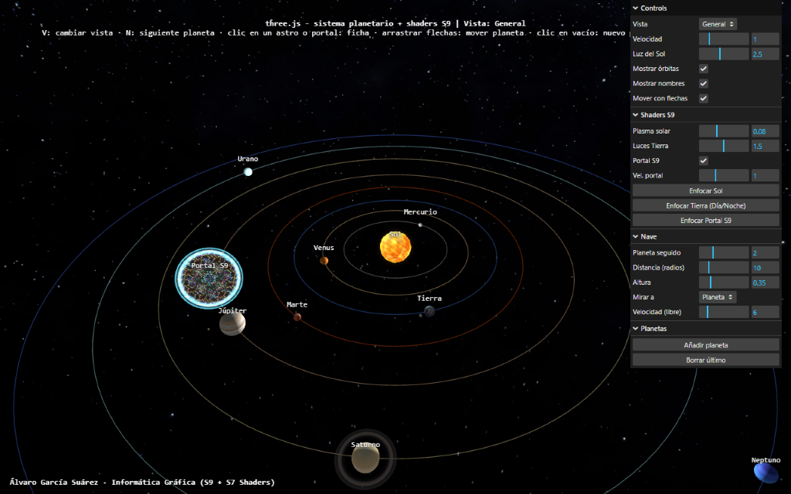
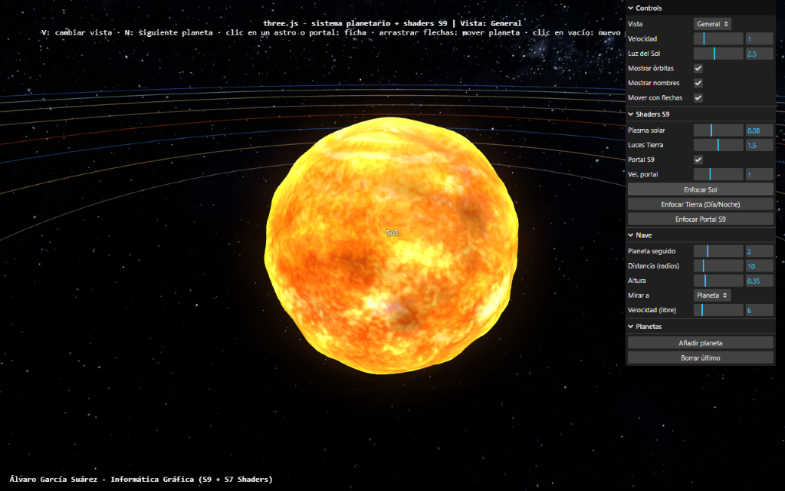
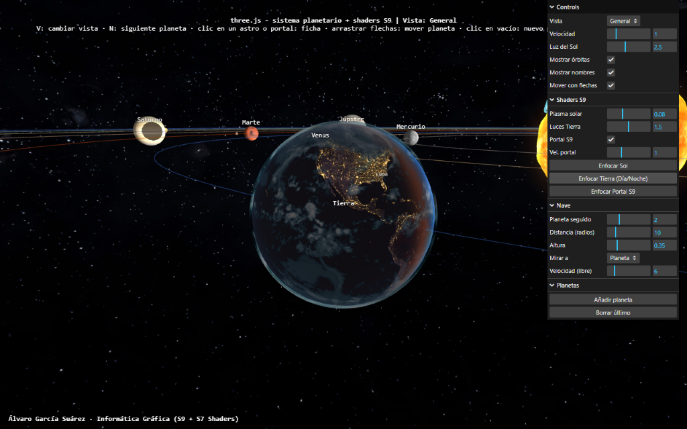
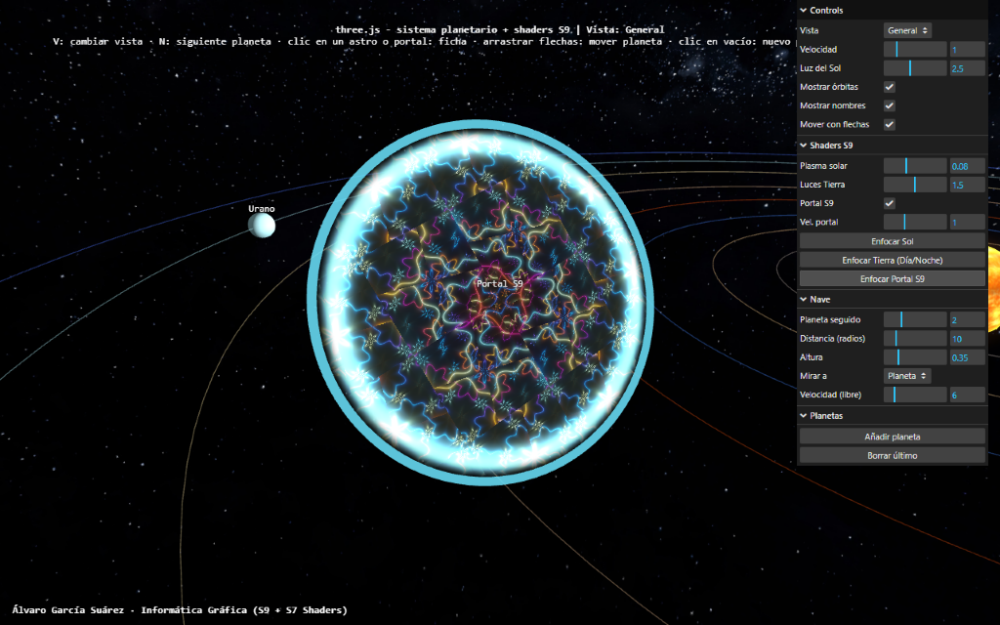

# Extra S9 — Integración de Shaders en el Sistema Planetario (S7)

**Enlace en vivo:** [https://codesandbox.io/p/sandbox/entrega-s9-s7-shader-fcl54y](https://codesandbox.io/p/sandbox/entrega-s9-s7-shader-fcl54y)

Copia independiente de la práctica **S7 (Sistema Planetario 3D)** en JavaScript vanilla y Three.js a la que se han añadido **tres shaders GLSL**.

## Capturas

| Sol animado (plasma y corona) | Tierra Día/Noche y atmósfera | Portal Caleidoscópico S9 |
| :---: | :---: | :---: |
|  |  |  |

## Shaders integrados ([src/script.js](./src/script.js))

1. **Sol animado (plasma + corona)**: deforma suavemente la superficie del Sol en movimiento, anima la textura `sun.jpg` para simular plasma y añade una corona brillante alrededor.
2. **Tierra Día/Noche + atmósfera**: mezcla la cara diurna (`earth.jpg`) con las luces nocturnas (`earth_lights_2k.png`) según la orientación respecto al Sol, con una franja cálida de atardecer y un halo azulado atmosférico.
3. **Portal Caleidoscópico S9**: integra el patrón generativo de [../shader.frag](../shader.frag) como un portal flotante en el espacio con borde luminoso y ficha interactiva al hacer clic.

## Controles añadidos (`Shaders S9` en `lil-gui`)

- **Plasma solar**: intensidad del movimiento superficial del Sol.
- **Luces Tierra**: brillo de las ciudades en la cara nocturna.
- **Portal S9** y **Vel. portal**: activar/desactivar el portal y ajustar su velocidad.
- **Enfocar Sol / Enfocar Tierra (Día/Noche) / Enfocar Portal S9**: accesos rápidos para ver cada shader de cerca.
